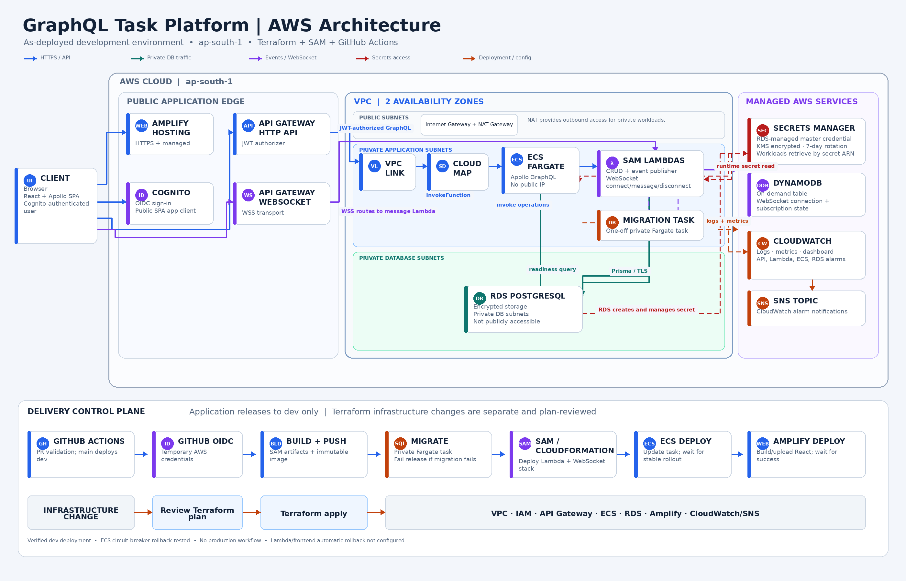
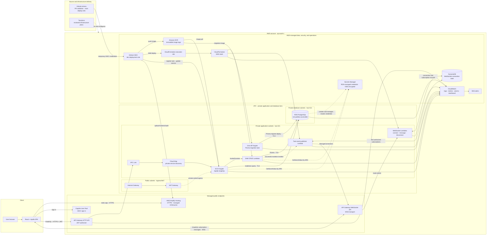
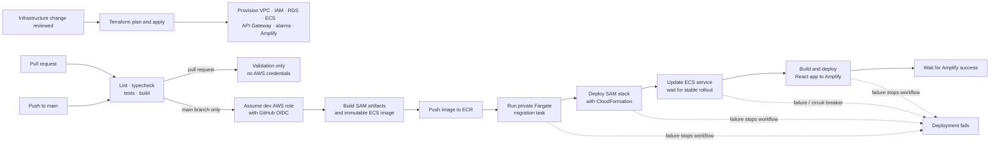

# Deployed Architecture

This diagram describes the **development environment that is deployed and verified**. It is not a production architecture. The frontend is hosted by AWS Amplify; the private GraphQL service runs on ECS Fargate; SAM manages the Lambda and WebSocket resources.

## Architecture diagram

The diagram separates the runtime request/data paths from the CI/CD control plane. Solid arrows show request, event, or data flow; dashed arrows show configuration, credential-management, or deployment relationships. GitHub Actions deploys the application; Terraform is used separately to provision and update infrastructure after a reviewed plan.

## Deployment pipeline

Terraform infrastructure changes are applied separately after plan review; the application deployment workflow does not run Terraform. Only the `main` branch deploy job assumes AWS credentials, and it targets the `dev` GitHub Environment. Pull requests run validation only. The migration task runs before SAM and ECS application updates; a migration failure stops deployment.

## Request and event flow

1. Amplify serves the React single-page application over HTTPS. Its managed hosting CDN serves static assets; hashed assets use long-lived cache headers and `index.html` is revalidated.
2. The browser signs in with Cognito. It sends its JWT to the API Gateway HTTP API, whose JWT authorizer validates the request before forwarding it through a VPC Link to Cloud Map and the private ECS service.
3. Apollo GraphQL applies application-level authorization and invokes the relevant SAM-managed Lambda operation using its ECS task role. The Lambda performs the database operation with Prisma. ECS also connects to PostgreSQL for its readiness check.
4. For subscriptions, the browser connects to API Gateway WebSocket over WSS. The message Lambda validates the token during `connection_init` and persists connection/subscription state in DynamoDB. A successful mutation invokes the publisher Lambda, which sends protocol messages using the API Gateway Management API to authorized connections.
5. RDS manages the database credential in Secrets Manager. ECS and Lambda receive the secret ARN as configuration and fetch the value at runtime using IAM roles. The secret value is not passed through GitHub Actions.
6. CloudWatch collects service logs and metrics; configured alarms notify the SNS topic.

## Network and security boundaries

- VPC contains public edge/NAT subnets, private application subnets, and private database subnets across two Availability Zones.
- API Gateway is the public HTTPS entry point. ECS tasks have no public IP. RDS is configured as not publicly accessible.
- Security groups limit database access to application workloads. Lambda and ECS roles have separate permissions; secret read access is scoped to the RDS-managed secret ARN.
- GitHub Actions obtains temporary AWS credentials through OIDC. The deploy job is limited to the `dev` GitHub Environment and the trusted `main` branch.

## CI/CD and ownership boundaries

- GitHub Actions validates pull requests and deploys from `main` to **development only**. There is no production deployment workflow.
- Deployment builds Lambda artifacts and the ECS image, runs migrations as a private one-off ECS task, deploys SAM, updates ECS and waits for service stability, then builds and deploys the frontend to Amplify.
- Terraform owns the VPC/network, IAM foundations, ECS/RDS, API Gateway HTTP ingress, Amplify, alarms, dashboard, and SNS topic. SAM/CloudFormation owns Lambda and WebSocket resources. Do not manage the same resource in both tools.

## Verified behavior and known limits

- ECS rollback is enabled through the deployment circuit breaker and was exercised with an intentionally missing image; ECS returned to a healthy task definition. Current dev service is healthy.
- Failed SAM/CloudFormation updates roll back as part of stack deployment. Lambda aliases for instant rollback are not configured.
- A successful but faulty Lambda or frontend release requires a manual source revert and redeployment. Automated Lambda alias promotion and frontend artifact restoration are not configured.
- Dev is cost-conscious, not production highly available: the current service has one desired ECS task and RDS is not configured as a production Multi-AZ deployment. Production deployment is out of scope.
- CloudWatch alarms and the dashboard are deployed; recent dev verification showed alarms in `OK`. Missing datapoints are treated as non-breaching for low-traffic API/Lambda alarms.

See [deployment](./deployment.md), [CI/CD](./ci-cd.md), [security](./security.md), [database](./database.md), [monitoring](./monitoring.md), and [rollback](./rollback.md) for operational details and commands.
