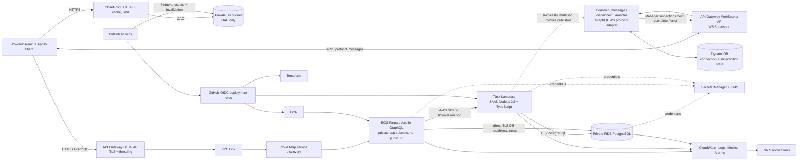

# Recommended Assessment Architecture

This is the recommended **target architecture** for the original assessment PDF. It does not use an Application Load Balancer. The PDF requires cost-conscious frontend hosting, private ECS GraphQL compute, Lambda operations, private RDS, scaling, security, CI/CD, monitoring, and rollback; it does not prescribe an ALB or a specific public ingress service.

> **Implementation status:** this document is a target design, not proof that AWS resources have been deployed. Terraform has been changed to define the no-ALB ingress, but the configuration still needs final validation, a reviewed AWS plan, and deployment testing. Do not claim this target is running until those checks pass.

## Architecture diagram

## Request and event flow

1. CloudFront serves the React bundle from a private S3 bucket using Origin Access Control. The browser never accesses the bucket directly.
2. The browser sends GraphQL HTTP requests to the regional API Gateway HTTP API over HTTPS.
3. API Gateway routes the request over a VPC Link to the private ECS service, discovered through Cloud Map. ECS tasks have no public IP.
4. Apollo validates the JWT and authorization, derives the user identity from verified claims, then invokes the appropriate SAM-managed task Lambda using its task role.
5. Lambda handlers validate the trusted event, enforce task ownership, and access PostgreSQL. ECS also has a direct PostgreSQL connection for `databaseHealth`/readiness; that path is not routed through Lambda.
6. For subscriptions, the browser opens WSS and sends its bearer token in the GraphQL `connection_init` payload (`connectionParams`), not in a URL or browser-supplied identity field. The connect route creates a short-lived pending record; the message adapter verifies the JWT during initialization, acknowledges only a valid identity, then persists authorized subscription operation state in DynamoDB. A successful mutation handler invokes the publisher asynchronously; the publisher sends protocol-compliant GraphQL `next` messages to authorized clients.

The HTTP API's VPC Link must target a Cloud Map service registered by the ECS service. Permit the VPC Link security group to reach the ECS task security group on the GraphQL container port; do not allow public ingress directly to ECS.

The WebSocket message Lambda is an explicit `graphql-transport-ws` adapter. `$connect` only establishes transport; the browser sends its Cognito ID token in `connection_init`, where the Lambda verifies issuer, audience, signature, and subject against the Cognito JWKS before acknowledging and persisting the authenticated connection. It validates `taskChanged` subscription documents against the GraphQL schema, stores multiple operation IDs per connection, handles ping/pong, completion, duplicate initialization, and disconnect cleanup, and sends GraphQL execution results using `next`/`error` protocol messages. API Gateway WebSocket only transports routed messages; it does not automatically implement GraphQL subscription semantics. Do not put bearer tokens in query strings, where they can leak through URL/access logs. Mutation Lambdas invoke the publisher only after a successful database commit; the publisher selects subscribers for that verified user and executes each stored selection set against the event before delivery. Do not use process-local Pub/Sub for cross-task delivery.

## Why this design

- **Assessment coverage:** includes React, GraphQL on private ECS, multiple SAM Lambdas, PostgreSQL, CI/CD, monitoring, secrets, IAM, scaling, rollback, and a diagram.
- **No ALB:** removes the ALB's hourly and LCU charges, but does not mean ingress has no fixed cost: VPC Link capacity is also billed over time, and WebSocket API, Cloud Map, and data-transfer charges still apply. The actual lower-cost option depends on request volume and regional prices; compare both complete designs in the AWS Pricing Calculator.
- **Private compute:** the public API endpoint is the controlled ingress; ECS and RDS remain private. “Private GraphQL server” refers to the ECS service and its network placement, not an unreachable browser endpoint.
- **One ownership per resource:** Terraform owns VPC, VPC Link, HTTP API integration, Cloud Map service, ECS, RDS, IAM foundations, CloudFront/S3, alarms, and SNS. SAM owns Lambda functions and the WebSocket API/DynamoDB subscription resources, unless those are deliberately moved wholly to Terraform. Never let both tools manage the same resource.
- **Trade-off:** API Gateway + VPC Link + Cloud Map adds configuration and operational complexity compared with ALB. It is the selected no-ALB target to evaluate against the assessment's cost goal, not a guaranteed cheaper option at any traffic level.

## Cost and scaling plan

### Development cost controls

- Start with one ECS task and a small single-AZ RDS instance. Do not call this highly available.
- Prefer CloudFront caching and API Gateway HTTP API for modest/irregular public request volume. Set API throttles and payload limits. Compare it with ALB using expected requests, active connections, processed bytes, VPC Link hours, WebSocket connection minutes/messages, and Cloud Map usage in `ap-south-1`; do not assume one design is always cheaper.
- Review the full `ap-south-1` estimate for HTTP API, VPC Link, Cloud Map, WebSocket messages/connection minutes, ECS, RDS, RDS Proxy (if retained), NAT, logging, and data transfer before provisioning.
- Review NAT Gateway versus VPC endpoints. Both can add hourly/data-processing costs; preserve required private egress and do not trade away private ECS/RDS.
- Make RDS Proxy conditional on the measured connection pattern and regional cost. If omitted, cap Lambda concurrency and database pool sizes. The current AWS account quota is 10 concurrent executions, so functions currently share that unreserved pool; configure per-function reservations only after the account quota is raised.
- Set CloudWatch log retention explicitly, keep dev log volume controlled, and tear down disposable resources after evidence capture.
- Use CloudFront caching for static assets. Keep `index.html` short-lived/revalidating and hashed assets long-lived.

### Scaling behavior

- **ECS:** configure Application Auto Scaling for desired task count with a small dev minimum and a budgeted maximum. Scale using measured CPU/memory or request count; verify scale-out and scale-in.
- **Lambda:** Lambda scales with demand within the account concurrency quota. The current 10-execution quota is shared across the platform functions; request a quota increase before assigning per-function reserved concurrency to protect database capacity. Measure duration, errors, throttles, and concurrency.
- **RDS:** scale vertically and configure storage autoscaling where supported. Add read replicas only when measured read pressure and regional cost justify them. Multi-AZ is for availability, not read scaling.
- **API Gateway:** applies managed request handling and configurable throttling/quotas; monitor 4xx/5xx, latency, throttles, and usage. It does not scale ECS or RDS by itself.
- **High availability trade-off:** one ECS task and single-AZ RDS are cost-conscious dev settings, not resilient production settings. Production availability needs multiple ECS tasks across AZs and an appropriately available database, which costs more.

## CI/CD and recovery

GitHub Actions validates code, tests, builds the frontend/container/Lambda artifacts, and authenticates to AWS using OIDC. Terraform plans are reviewed before apply. SAM deploys Lambda resources. The ECS image uses immutable tags; failed ECS deployments roll back through the service circuit breaker. Frontend releases retain prior assets for restore. Production requires a protected GitHub Environment and approval. Database migrations use expand/contract and a separately documented recovery plan.

## Required acceptance evidence

Do not mark this target complete until evidence demonstrates:

- private S3 access through CloudFront OAC and HTTPS;
- API Gateway HTTP API → VPC Link → Cloud Map → healthy private ECS task;
- no public IP on ECS tasks and no public RDS access;
- GraphQL CRUD through ECS and Lambda, plus a separate ECS database health/readiness check;
- authenticated, authorized `graphql-transport-ws` subscription delivery across multiple ECS tasks/clients and cleanup after disconnect;
- ECS autoscaling, Lambda concurrency limits, CloudWatch alarms/SNS delivery, and rollback behavior;
- Terraform/SAM ownership boundaries, GitHub OIDC, and absence of committed/runtime-secret leakage.
- HTTP API and WebSocket API authentication, throttling, WSS, subscription authorization, and publisher delivery of GraphQL execution results.

## Assessment traceability

| Original assessment deliverable | Architecture component | How to verify |
|---|---|---|
| React frontend interacts with GraphQL | React + Apollo Client; API Gateway HTTP API | Browser performs task CRUD against the deployed GraphQL endpoint |
| Cost-optimized frontend with caching, access control, and SSL | Private S3 + CloudFront OAC + HTTPS; immutable asset caching and revalidating HTML | Direct S3 access is denied; CloudFront works over HTTPS; inspect cache headers |
| Multiple TypeScript/Node.js Lambda functions for queries, mutations, and subscriptions | SAM-managed CRUD, publisher, and WebSocket route handlers | `sam validate`, `sam build`, deployed function list, and handler tests |
| Private GraphQL server on ECS Fargate | Apollo ECS service in private subnets with no public IP; API Gateway is controlled ingress | ECS task subnet/ENI inspection; GraphQL smoke test through HTTPS API |
| Private RDS and connectivity from ECS and Lambda | PostgreSQL in private DB subnets; security-group-restricted access from ECS/Lambda, optionally via RDS Proxy | RDS is not publicly accessible; separately verify Lambda DB operation and ECS direct DB health check |
| Lambda/GraphQL/RDS integration | ECS invokes operation Lambdas; handlers use Prisma and PostgreSQL | End-to-end create/read/update/delete and ownership tests |
| GitHub Actions build and deployment | PR validation and protected deployment workflows; OIDC roles | Workflow logs show tests/builds before deploy and AWS identity obtained through OIDC |
| CloudWatch logs, metrics, alarms, notifications | CloudWatch for ECS/Lambda/RDS/API Gateway; alarms notify SNS | Inspect logs/metrics, deliberately trigger a dev alarm, confirm SNS delivery |
| IAM access control and secrets management | Separate ECS/Lambda/deployment roles; Secrets Manager + KMS | Review scoped policies/trust conditions; verify no plaintext credentials in source, task definitions, or logs |
| Scaling of ECS, Lambda, and RDS | ECS Application Auto Scaling; Lambda concurrency limits; RDS vertical/storage scaling and optional replicas | Demonstrate ECS scale-out/in; inspect Lambda concurrency/metrics; document RDS scaling decision from measurements |
| Rollback to previous stable version | ECS deployment circuit breaker and prior task definition; prior frontend artifact; Lambda version/alias strategy | Run and record a controlled dev rollback drill |
| Architecture diagram and detailed documentation | This diagram plus deployment, security, database, CI/CD, monitoring, and rollback guides | Review docs against this table and attach sanitized evidence |

### Security and operational requirements included in the design

- **Authentication and authorization:** use an approved OIDC provider; verify JWT signature, issuer, audience, and expiry at the GraphQL/API boundary. Derive identity from verified claims. Enforce per-user ownership in every query, mutation, and subscription. No browser-supplied user ID is trusted.
- **WebSocket authentication:** authenticate during `connection_init` using the protocol's connection parameters over WSS, set a short timeout for unauthenticated connections, and reject subscribe operations until the connection is authenticated. Never treat successful `$connect` as proof of user identity.
- **Secret handling:** RDS manages the master credential in Secrets Manager, encrypted with KMS. ECS and each Lambda role can read only that secret ARN. Do not put secret values in frontend variables, GitHub files, container layers, Terraform state/outputs, or logs.
- **Network access:** only API Gateway's VPC Link security group can reach the ECS task port. ECS and Lambda reach PostgreSQL only on the database port. RDS has no public access. Keep task public IP assignment disabled.
- **CI/CD gates:** pull requests run lint, type checks, unit/integration tests, dependency/security checks, frontend/backend builds, `sam validate`, and Terraform fmt/validate/plan. Deploy only from protected branches/environments through OIDC. Do not grant production credentials to untrusted pull requests.
- **Monitoring:** retain structured, redacted logs; monitor Lambda errors/duration/throttles/concurrency, ECS desired/running count/CPU/memory, API Gateway latency/4xx/5xx/throttles, and RDS connections/CPU/free storage/latency. Alarm thresholds must be set from a tested baseline and notify SNS.
- **Recovery:** preserve previous immutable image/task definition, Lambda version, and frontend artifact. Stop promotion on failed smoke tests. Roll back application artifacts without assuming database migrations can be automatically reversed; use backward-compatible expand/contract migrations and tested backups.
- **Cost-aware scaling:** cap dev ECS desired count, set Lambda concurrency to the database's safe connection budget, and do not add RDS replicas until metrics justify the spend. Scale ECS/Lambda independently; RDS requires planned vertical/storage changes or deliberate replica/availability configuration.

This traceability is a **design mapping, not completion evidence**. The design includes every assessment category, but infrastructure and deployment paths still require validation and deployment; in particular, WebSocket handlers are not yet a complete GraphQL protocol adapter. Do not mark requirements complete until their tests and deployment evidence exist. The selected no-ALB ingress is an engineering choice: the original PDF does not require ALB or API Gateway specifically.

## References

- [Original assessment](../Mid%20level%20DevOps%20Assessment.pdf)
- [Implementation guide](../GraphQL_Serverless_Platform_Assessment_Implementation_Guide_v2.md)
- [API Gateway VPC Link v2](https://docs.aws.amazon.com/apigateway/latest/developerguide/apigateway-vpc-links-v2.html)
- [API Gateway pricing](https://aws.amazon.com/api-gateway/pricing/)
- [Application Load Balancer pricing](https://aws.amazon.com/elasticloadbalancing/pricing/)
